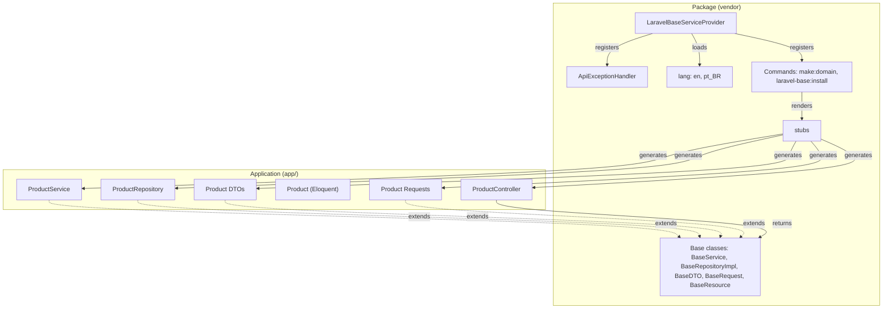

# Architecture

## Goal

Give a Laravel API a consistent, layered structure with almost no code to write per entity. The package ships the base classes, the response and error conventions and a generator. The generator creates thin classes in your application that extend the bases, so your project owns its code and can override any behaviour.

## Two sides

| Side | Lives in | Contains |
|---|---|---|
| Package | `vendor/jponchiroli/laravel-base` | Base classes (`src/Base`), commands (`src/Console`), error handler (`src/Exceptions`), translations (`lang`), stubs (`stubs`), config (`config`) |
| Application | your `app/` | Classes generated by `make:domain` for each entity; they extend the package bases |

## What the service provider does

`LaravelBaseServiceProvider` is discovered automatically by Composer. On boot it:

1. merges `config/laravel-base.php` under the `laravel-base` key;
2. loads the translations under the `laravel-base` namespace (`laravel-base::messages.*`, `laravel-base::validation.*`);
3. when `exception_handler` is enabled, registers the standardized JSON error renderers on the application exception handler;
4. in the console, registers `make:domain` and `laravel-base:install` and the publishable tags (see [install-and-configuration.md](install-and-configuration.md)).

## Design decisions

- **Inheritance over configuration.** Behaviour lives in base classes; generated classes are empty subclasses. To change behaviour for one entity you override a method in that entity's class.
- **Generated code belongs to the project.** The generator never overwrites existing files, so generated classes can be edited freely.
- **Data travels as DTOs.** Controllers never pass the request or arrays to services; see [dtos.md](dtos.md).
- **One response contract.** Resources and the exception handler guarantee the same envelope everywhere; see [responses-and-errors.md](responses-and-errors.md).
- **Validation messages are derived, not written.** See [validation-and-i18n.md](validation-and-i18n.md).
- **English everywhere except `lang/pt_BR`.** Enforced by a test.

## Package source map

| Path | Role |
|---|---|
| `src/Base/BaseService.php` | Service layer: delegates to a `BaseRepository` |
| `src/Base/BaseRepository.php`, `BaseRepositoryImpl.php` | Repository contract and Eloquent implementation |
| `src/Base/BaseDTO.php`, `BaseCreateDTO.php`, `BaseUpdateDTO.php`, `BasePatchDTO.php`, `BaseIndexDTO.php` | Data transfer objects |
| `src/Base/BaseRequest.php` | FormRequest with derived messages |
| `src/Base/BaseResource.php`, `BaseStoreResource.php`, `BaseMessageResource.php`, `BaseCollection.php`, `Concerns/PutsMessageFirst.php` | Response resources |
| `src/Exceptions/ApiExceptionHandler.php` | Standardized error responses |
| `src/Console/MakeDomainCommand.php`, `InstallCommand.php` | Generator and installer |
| `lang/{en,pt_BR}/{messages,validation}.php` | Translations |
| `stubs/*.stub` | Templates used by `make:domain` |
