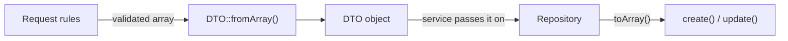

# DTOs

DTOs carry validated data from the controller to the service and repository. The controller builds one with `XDTO::fromArray($request->validated())`; the repository reads it with `toArray()`.

## Flow



Only fields declared in the Request rules survive validation, so the rules double as the mass-assignment whitelist (the model's `$fillable` is the second guard).

## The DTO types

| Class | Generated as | Carries | Used by |
|---|---|---|---|
| `BaseDTO` | `{Name}IdDTO` (with a typed `id`) | Contract: `fromArray(array): self` and `toArray(): array` (public properties) | `show`, `destroy` |
| `BaseCreateDTO` | `{Name}CreateDTO` | All validated attributes | `store` |
| `BaseUpdateDTO` | `{Name}UpdateDTO` | `id` plus the validated attributes | `update` |
| `BasePatchDTO` | `{Name}PatchDTO` | `id` plus the validated attributes | `patch` |
| `BaseIndexDTO` | `{Name}IndexDTO` | `filters` (all validated fields except `per_page` and `page`) and `perPage` | `index` |

`BaseUpdateDTO` extends `BasePatchDTO`; the difference between a full update and a patch lives in the repository, not in the DTO.

## `null` semantics

| Operation | Sent `{"color": null}` | Field not sent |
|---|---|---|
| `store` | `null` is stored | column default |
| `update` | `null` is written | unchanged (only sent fields are written) |
| `patch` | ignored, value unchanged | unchanged |
| `index` filter | ignored (no `where`) | no filter |

## Typed DTOs (optional)

The generated DTOs need no code. If you prefer typed properties, replace the class body and implement `fromArray`. The property names must match the column names because `toArray()` goes straight to Eloquent.

```php
class ProductCreateDTO extends BaseDTO
{
    public function __construct(
        public string $name,
        public ?float $price = null,
    ) {}

    public static function fromArray(array $data): self
    {
        return new self($data['name'], $data['price'] ?? null);
    }
}
```

A typed DTO silently drops every field it does not declare, so keep it in sync with the Request rules.

## Reserved names

`id` is reserved in the Update, Patch and Id DTOs and stands for the primary key whatever the column is called. The route parameter must be named `{id}`.
