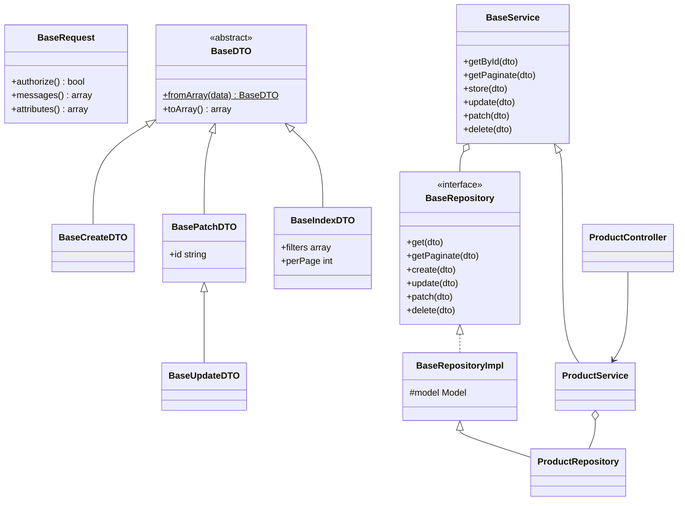

# Layers

Each layer has one responsibility. Generated classes are empty subclasses of the base class listed here; override a method only when an entity needs different behaviour.

| Layer | Generated class | Extends | Responsibility |
|---|---|---|---|
| Route | block in `routes/api.php` | n/a | Maps verbs and URLs to controller methods |
| Request | `{Name}{Index,Store,Update,Patch,Delete}Request` | `BaseRequest` | Authorizes (always `true`), validates, derives messages |
| Controller | `{Name}Controller` | `App\Http\Controllers\Controller` | HTTP adapter: request in, DTO built, service called, Resource out |
| DTO | `{Name}{Create,Update,Patch,Id,Index}DTO` | `BaseCreateDTO`, `BaseUpdateDTO`, `BasePatchDTO`, `BaseDTO`, `BaseIndexDTO` | Immutable-by-convention data carrier between layers |
| Service | `{Name}Service` | `BaseService` | Business rules and orchestration; no HTTP, no Eloquent |
| Repository | `{Name}Repository` | `BaseRepositoryImpl` | Persistence through Eloquent; the only layer that knows the model |
| Model | `{Name}` | `Illuminate\Database\Eloquent\Model` | Table mapping, `$fillable`, relations |
| Resource | none (package classes) | `BaseResource` family | Response envelope |



## Rules of the road

- A layer only calls the layer directly below it: Controller -> Service -> Repository -> Model.
- Controllers contain no business logic and no queries. Services contain no HTTP and no Eloquent. Repositories contain no business decisions.
- The service constructor takes the entity repository and passes it to `BaseService`; the repository constructor takes the model and passes it to `BaseRepositoryImpl`. Both are resolved by the container.

## Base class reference

### `BaseService`

| Method | Delegates to | Returns |
|---|---|---|
| `getById(BaseDTO)` | `repository->get` | `?Model` |
| `getPaginate(BaseIndexDTO)` | `repository->getPaginate` | `LengthAwarePaginator` |
| `store(BaseDTO)` | `repository->create` | `Model` |
| `update(BaseDTO)` | `repository->update` | `?Model` |
| `patch(BaseDTO)` | `repository->patch` | `?Model` |
| `delete(BaseDTO)` | `repository->delete` | `bool` |

### `BaseRepositoryImpl`

| Method | Behaviour |
|---|---|
| `getTable()` | Table name of the model |
| `get(dto)` | `find(dto->toArray()['id'])`; ids that are not int or string give `null` |
| `getPaginate(dto)` | Applies `where(field, value)` for every filter that is not `null`, then `paginate(perPage ?? model->getPerPage())` |
| `create(dto)` | `newQuery()->create(dto->toArray())` (mass assignment: respects `$fillable`) |
| `update(dto)` | Removes `id` from the attributes, finds the record, `update(attributes)`; `null` when not found |
| `patch(dto)` | Same as `update` but drops attributes whose value is `null` |
| `delete(dto)` | Finds the record and deletes it; `false` when not found |

### Adding behaviour to one entity

```php
class ProductRepository extends BaseRepositoryImpl
{
    public function __construct(Product $model)
    {
        parent::__construct($model);
    }

    public function cheaperThan(float $value): Collection
    {
        return $this->model->newQuery()->where('price', '<', $value)->get();
    }
}
```

Expose it through the service (`ProductService` keeps its own typed repository property) and call it from a controller method.
