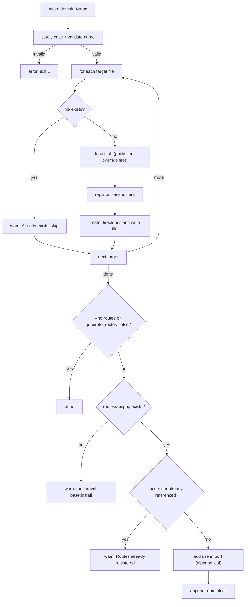

# The `make:domain` command

```bash
php artisan make:domain Product            # classes + routes
php artisan make:domain Product --no-routes # classes only
php artisan make:domain Product --no-docs   # skip app/Docs/Product/ProductDocs.php
php artisan make:domain Product --no-migration # skip the migration
```

The name is normalized with `Str::studly` (`product`, `blog_post`, `blog-post` and `blogPost` all work) and must then match `^[A-Z][A-Za-z0-9]*$`, otherwise the command prints `Invalid name: ...` and fails.

## What happens



## Generated files

For `Product` (paths relative to `app/`):

| Stub | File | Extends |
|---|---|---|
| `model` | `Models/Product.php` | `Illuminate\Database\Eloquent\Model` |
| `controller` | `Http/Controllers/ProductController.php` | `Controller` |
| `service` | `Services/Product/ProductService.php` | `BaseService` |
| `repository` | `Repositories/Product/ProductRepository.php` | `BaseRepositoryImpl` |
| `dto.create` | `DTOs/Product/ProductCreateDTO.php` | `BaseCreateDTO` |
| `dto.update` | `DTOs/Product/ProductUpdateDTO.php` | `BaseUpdateDTO` |
| `dto.patch` | `DTOs/Product/ProductPatchDTO.php` | `BasePatchDTO` |
| `dto.id` | `DTOs/Product/ProductIdDTO.php` | `BaseDTO` |
| `dto.index` | `DTOs/Product/ProductIndexDTO.php` | `BaseIndexDTO` |
| `request.index` | `Http/Requests/Product/ProductIndexRequest.php` | `BaseRequest` |
| `request.store` | `Http/Requests/Product/ProductStoreRequest.php` | `BaseRequest` |
| `request.update` | `Http/Requests/Product/ProductUpdateRequest.php` | `BaseRequest` |
| `request.patch` | `Http/Requests/Product/ProductPatchRequest.php` | `BaseRequest` |
| `request.delete` | `Http/Requests/Product/ProductDeleteRequest.php` | `BaseRequest` |

Requests and DTOs live in one folder per domain, with the folder name as the last namespace segment (`App\Http\Requests\Product`, `App\DTOs\Product`). The root namespace comes from the application (`App` by default).

## Routes

When `routes/api.php` exists and the controller is not referenced yet, the command:

1. adds `use App\Http\Controllers\ProductController;` to the import block at the top of the file, in alphabetical position (or right after `<?php` when the file has no imports), keeping the file's line endings;
2. appends the route block from `routes.stub`: prefix `{config route_prefix}/{kebab-case plural}`, six routes (`index`, `show`, `store`, `update`, `patch`, `destroy`) written as `ProductController::class`.

Running the command twice never duplicates the import or the routes.

## OpenAPI documentation

Unless `--no-docs` is given, the command also writes [swagger-php](https://zircote.github.io/swagger-php/) classes (`OA` attributes) in `app/Docs/`:

| File | Content |
|---|---|
| `Docs/SchemaDocs.php` | Created once. `#[OA\Info]`, one `#[OA\Tag]` per domain (added by every `make:domain`) and the shared schemas `Error`, `ValidationError` and `Message` |
| `Docs/Product/ProductDocs.php` | The six endpoints plus the schemas of the domain: `Product` (model), `ProductStoreRequest`, `ProductUpdateRequest`, `ProductPatchRequest`, `ProductResource` and `ProductCollection` |

- **Request fields** come from `rules()` of the domain Requests (query parameters for `index`, JSON body for `store`, `update` and `patch`). String rules are mapped to type, format, `required`, `nullable`, `min`/`max` and `in`; rule objects, nested and wildcard fields are ignored.
- **Model fields** come from the columns of the model table, read through the connection of the model. `make:domain` uses only `id`, `created_at` and `updated_at` while the table does not exist yet, but `domain:docs` never does: when the model or its table is missing it prints an error (`Domain Ghost not found: ...` or `Table 'products' not found: run the migration first.`), writes nothing and exits with failure. With no name, domains that fail are skipped and the others are still updated.
- Error responses (401, 403, 404, 422, 500) reference the shared schemas.

At generation time the Store, Update and Patch rules are empty and the table usually does not exist, so run `php artisan domain:docs Product` after filling them and migrating (or `php artisan domain:docs` without a name for every domain, even those without a docs class yet). It rewrites `ProductDocs.php`, so manual edits there are lost; `make:domain` never overwrites it. `SchemaDocs.php` is never rewritten.

`make:domain` and `domain:docs` also write the merged document to `storage/api-docs/openapi.json`. Swagger UI is served at `/docs` and reads `/docs/openapi.json`, which returns that file (or scans `app/Docs` when the file does not exist yet). After editing `app/Docs` by hand, run `php artisan domain:docs` to refresh it. Change or disable it with the `swagger` config key. Only the six stub routes are documented.

## Migration

As the last step the command runs Laravel's `make:migration create_products_table --create=products` (table name: snake-case plural of the entity, the same the model uses). If a `*_create_products_table.php` migration already exists it prints `Migration already exists: create_products_table` and creates nothing. Use `--no-migration` to skip it. The migration is only the empty Laravel template: define the columns, run `php artisan migrate` and then `php artisan domain:docs Product` so the model schema of the docs gets the new columns.

## Stubs and placeholders

Stubs are in `stubs/*.stub`. To change generated code project-wide, publish them:

```bash
php artisan vendor:publish --tag=laravel-base-stubs
```

Files in `stubs/laravel-base/` (in your project) win over the package ones, stub by stub, so you can publish and keep only the stubs you changed.

| Placeholder | Value | Example |
|---|---|---|
| `{{ namespace }}` | Application root namespace | `App` |
| `{{ class }}` | Normalized entity name | `Product` |
| `{{ plural }}` | camelCase plural, used for the list variable | `products` |
| `{{ prefix }}` | `route_prefix` config (routes stub only) | `v1` |
| `{{ route }}` | kebab-case plural (routes stub only) | `products` |

## Idempotency and re-running

Existing files are never touched. To regenerate one file, delete it and run the command again; the other files are skipped with `Already exists: <path>`.

## Upgrading from flat Requests

Earlier versions generated Requests directly in `app/Http/Requests/`. They are now grouped per domain, like DTOs. To migrate an entity, move its five Requests into `app/Http/Requests/{Name}/`, change their namespace to `App\Http\Requests\{Name}` and update the imports in the controller. Re-running `make:domain` for an entity that still has flat Requests would generate a second set in the new folder.

## After generating

Three manual steps remain: the columns of the generated migration and `$fillable`, the Request rules, and a smoke test. [getting-started.md](getting-started.md) walks through them and [ai-agent-guide.md](ai-agent-guide.md) has the checklist.
