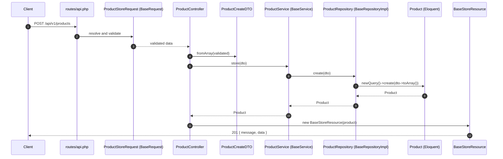
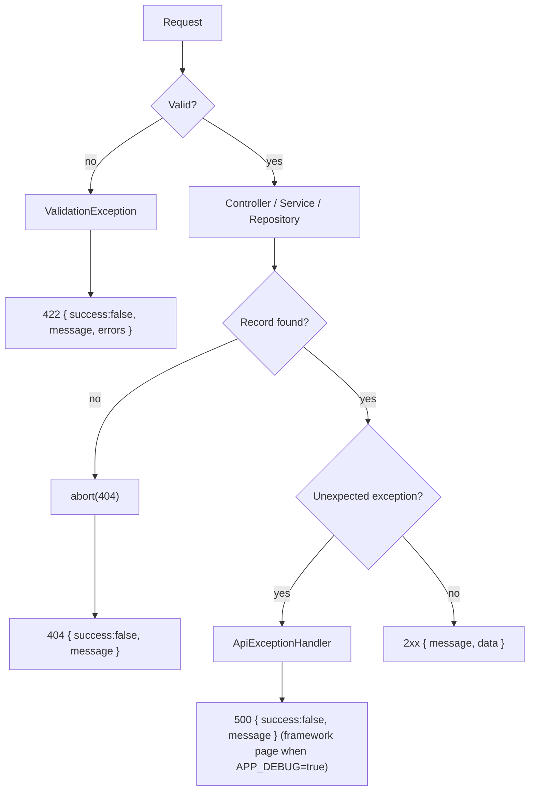

# Request lifecycle

How one HTTP request travels through the layers. The example is `POST /api/v1/products`.

## Success path

1. The route group (`v1/products`) points at a controller method.
2. Laravel resolves the typed `FormRequest`. `BaseRequest::authorize()` returns `true`; `rules()` come from the generated Request; the messages are derived from the rules.
3. If validation fails, the request never reaches the controller (see the error paths below).
4. The controller builds a DTO from `$request->validated()` and calls the service.
5. The service delegates to the repository, which is the only layer that touches Eloquent.
6. The controller wraps the model in a Resource. The Resource adds the translated `message` and puts it before `data`.

## Read and delete paths

| Endpoint | Controller | Service call | Repository behaviour | Result |
|---|---|---|---|---|
| `GET /products` | `index` | `getPaginate(IndexDTO)` | equality `where` per filled filter, then `paginate(per_page)` | 200 `{ message, data, meta }` |
| `GET /products/{id}` | `show` | `getById(IdDTO)` | `find(id)` | 200, or 404 when `null` |
| `PUT /products/{id}` | `update` | `update(UpdateDTO)` | `find(id)` then `update(attributes)` | 200, or 404 when `null` |
| `PATCH /products/{id}` | `patch` | `patch(PatchDTO)` | same as update but `null` values are dropped | 200, or 404 when `null` |
| `DELETE /products/{id}` | `destroy` | `delete(IdDTO)` | `find(id)?->delete()` | 200 `{ message }`, or 404 when `false` |

## Error paths

The exception handler only formats errors for `api/*` URLs or requests that expect JSON (`Accept: application/json`). Details in [responses-and-errors.md](responses-and-errors.md).
