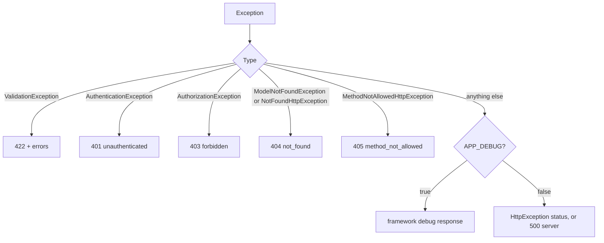

# Responses and errors

## Success responses

Every success body starts with `message`, then `data` (and `meta` for lists).

| Endpoint | Class | Status | Body | Message key |
|---|---|---|---|---|
| index | `BaseCollection` (via `BaseResource::collection()`) | 200 | `{ message, data: [...], meta }` | `success.index` |
| show | `BaseResource` | 200 | `{ message, data: {...} }` | `success.show` |
| store | `BaseStoreResource` | 201 | `{ message, data: {...} }` | `success.store` |
| update, patch | `BaseResource` with key `update` | 200 | `{ message, data: {...} }` | `success.update` |
| destroy | `BaseMessageResource` | 200 | `{ message }` | `success.destroy` |

`new BaseResource($model, 'update')` chooses the message key (default `show`). Message keys live in `lang/{locale}/messages.php` under `success`. An unknown key returns the translation key itself, so typos are visible.

### Pagination `meta`

Lists return a compact summary, in this order:

```json
{
  "message": "Records retrieved successfully.",
  "data": [ { "id": 1, "name": "Pen" } ],
  "meta": { "to": 1, "from": 1, "total": 10, "per_page": 1, "last_page": 10, "current_page": 1 }
}
```

There is no `links` block and no page-button list. An empty page keeps the shape (`from` and `to` are `null`, `total` is `0`).

### Why `message` comes first

Laravel resources append `with()` data after `data`. `BaseResource`, `BaseStoreResource` and `BaseCollection` use the `PutsMessageFirst` trait from `withResponse()` to move `message` to the top of the payload. Empty objects such as `{}` and the response status (201 on store) are preserved.

## Error responses

All errors use the same envelope:

```json
{ "success": false, "message": "Record not found." }
```

Validation errors add `errors`:

```json
{ "success": false, "message": "The given data was invalid.", "errors": { "name": ["The name field is required."] } }
```



Messages come from `lang/{locale}/messages.php` under `error`: `validation`, `not_found`, `unauthenticated`, `forbidden`, `method_not_allowed`, `server`.

### When the handler applies

`ApiExceptionHandler` formats an error only when the request URL matches `api/*` or the request expects JSON. Other requests keep Laravel's default rendering. It is registered by the service provider on the application exception handler, so it also works when a decorator such as Collision wraps the handler. Disable it with `'exception_handler' => false` in `config/laravel-base.php`.

## Writing your own endpoint

Return a Resource, never a raw model or `response()->json()`:

```php
public function summary(string $id): BaseResource
{
    $summary = $this->service->summary($id) ?? abort(404);

    return new BaseResource($summary, 'show');
}
```

`abort(404)` produces the standardized 404 body.
