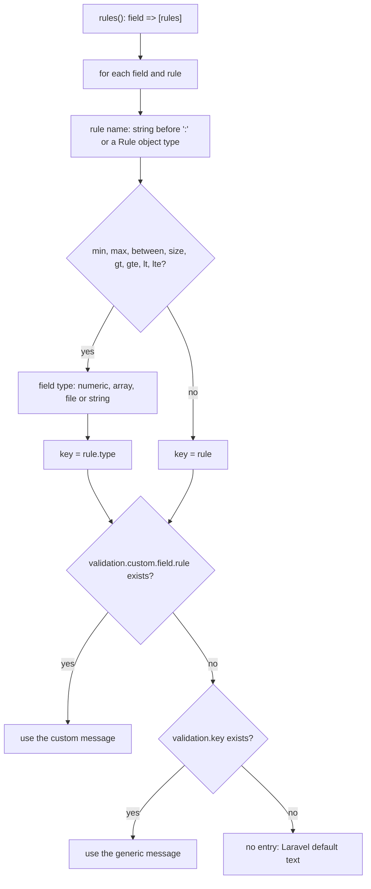

# Validation and translations

## The idea

Validation messages are not written per Request. `BaseRequest::messages()` reads the Request's `rules()` and builds one message for every `field.rule` pair from the package translations.

## Rule names

- String rules: the part before the first `:` (`max:100` -> `max`). Pipe strings (`'required|string'`) are split.
- Rule objects: `Rule::exists()` -> `exists`, `Rule::unique()` -> `unique`, `Rule::in()` -> `in`, `Rule::notIn()` -> `not_in`, `Rule::enum()` -> `enum`.
- Anything else (closures, custom rule classes, `nullable`, `sometimes`, `bail`, unknown names) produces no entry and falls back to Laravel's default text.

## Type-aware size rules

For `min`, `max`, `between`, `size`, `gt`, `gte`, `lt`, `lte` the wording depends on the field type, decided from the other rules of the same field:

| The field has any of | Type | Example wording |
|---|---|---|
| `integer`, `numeric`, `decimal` | numeric | "must be at least :min" |
| `array` | array | "must have at least :min items" |
| `file`, `image`, `mimes`, `mimetypes` | file | "must be at least :min kilobytes" |
| none of the above | string | "must be at least :min characters" |

Checks run in that order, so a field with both `integer` and `array` is numeric.

## Translation files

| File | Content |
|---|---|
| `lang/{locale}/messages.php` | `success.*` and `error.*` response messages |
| `lang/{locale}/validation.php` | one entry per rule (`required`, `email`, ...), nested per type for size rules, `custom`, and optional `attributes` |

Shipped locales: `en` and `pt_BR`. The active locale is `APP_LOCALE`; the folder name must match it exactly. If a locale folder is missing, Laravel falls back to `APP_FALLBACK_LOCALE`.

## Customizing

- **Edit the texts:** `php artisan vendor:publish --tag=laravel-base-lang` copies them to `lang/vendor/laravel-base`; Laravel prefers those over the package files.
- **One field, one rule:** add `'custom' => ['code' => ['digits' => 'The code needs :digits digits.']]` to the published `validation.php`. Custom entries win over generic ones.
- **Friendly field names:** add `'attributes' => ['first_name' => 'first name']` to the published `validation.php`, or override `attributes()` in a Request. Without it, `:attribute` shows the field name with underscores replaced by spaces.
- **A new language:** publish the translations, copy `lang/vendor/laravel-base/en` to `lang/vendor/laravel-base/{locale}`, translate, and keep the same keys and placeholders (`LangParityTest` enforces this for the shipped locales).
